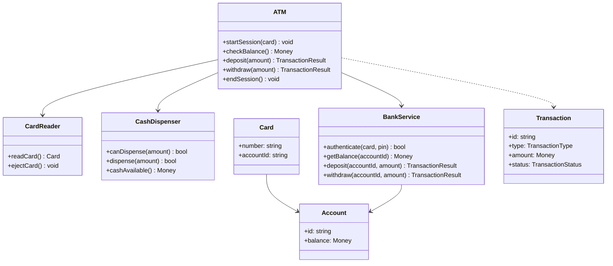

# LLD Question: Design an ATM

**Level:** Beginner

## Java example

The runnable example is in [`Main.java`](Main.java). It demonstrates a card session, PIN authentication, balance inquiry, deposits, withdrawals, and a dispenser with $20 and $50 notes. The bank and ATM state are in-memory so the example uses only the Java standard library.

```bash
cd atm
javac Main.java
java Main
```

## Interview prompt

Design a basic ATM. A customer inserts a bank card and enters a PIN. After authentication, the customer can check their balance, deposit cash, or withdraw cash. The ATM should dispense cash only when the account has enough money and the ATM has enough notes.

Describe the objects, the ATM's states, and how you would handle a withdrawal that cannot be completed.

## Requirements

### Functional requirements

- Read a card and authenticate its PIN with the bank.
- Allow balance inquiry, cash deposit, and cash withdrawal after authentication.
- Reject a withdrawal if the account balance or ATM cash is insufficient.
- Dispense cash and update the account only for a successful withdrawal.
- Accept a deposit and update the account.
- End the session and return the card when the customer chooses to finish.

### Assumptions

- The ATM supports one account per inserted card.
- Withdrawals use available $20 and $50 notes. The dispenser returns a valid combination or reports that it cannot make the requested amount.
- The bank system is the source of truth for account balances and PIN validation.
- Deposited cash is accepted as an amount for this basic design; note validation and deposit envelopes are out of scope.
- Network failure is reported to the customer and must not result in cash being dispensed without a confirmed withdrawal.

## Core objects

| Class | Responsibility |
| --- | --- |
| `ATM` | Coordinates the session and delegates operations to its devices and bank service. |
| `CardReader` | Reads and ejects the card. |
| `Keypad` | Collects the PIN and requested amount. |
| `Screen` | Displays prompts and operation results. |
| `CashDispenser` | Tracks available notes and dispenses a requested amount when possible. |
| `BankService` | Authenticates the card and performs account operations. |
| `Account` | Represents the bank-side balance for the card's account. |
| `Transaction` | Records a balance inquiry, deposit, or withdrawal result. |

## Basic class diagram



## ATM session states

```text
Idle -> CardInserted -> Authenticated -> ProcessingTransaction
  ^          |                |                 |
  |          +-- invalid PIN -+                 +-- operation complete
  +---------------- card ejected / session ended
```

An implementation can represent these as an `ATMState` enum and reject actions that are invalid for the current state. For example, a withdrawal is only allowed after successful authentication.

## Main flows

### Authenticate

1. Read the card and move from `Idle` to `CardInserted`.
2. Collect the PIN and ask `BankService.authenticate(card, pin)`.
3. On success, move to `Authenticated`.
4. On failure, show an error. For this exercise, allow up to three attempts, then eject the card and return to `Idle`.

### Withdraw cash

1. Check that the ATM can make the requested amount with its available notes.
2. Ask the bank to withdraw the amount from the account.
3. If the bank rejects the withdrawal, show the reason and do not dispense cash.
4. If the bank confirms it, dispense the cash and show a receipt or result.
5. If dispensing fails after bank approval, report a failed dispense and trigger a reversal or reconciliation with the bank. Do not silently treat the transaction as successful.

### Deposit cash

1. Collect the deposit amount.
2. Ask `BankService` to deposit it into the account.
3. Show the confirmed result and return to the authenticated state.

## Example interfaces

```text
ATM.startSession(card) -> SessionResult
ATM.authenticate(pin) -> AuthResult
ATM.checkBalance() -> Money
ATM.deposit(amount) -> TransactionResult
ATM.withdraw(amount) -> TransactionResult
CashDispenser.canDispense(amount) -> bool
CashDispenser.dispense(amount) -> bool
ATM.endSession() -> void
```

## Important rules and edge cases

- Require authentication before any account operation.
- Reject zero or negative deposit and withdrawal amounts.
- Check both account funds and the ATM's ability to dispense the requested notes.
- Do not dispense cash before receiving bank approval.
- Eject the card and clear session data when a session ends or authentication attempts are exhausted.
- A real system needs an explicit transaction protocol for failures between the bank and dispenser; discuss reversal and reconciliation rather than assuming both actions always succeed together.

## Possible follow-up questions

- How would you support multiple accounts on one card?
- How would the dispenser choose a note combination?
- How would you handle an ATM that loses network connectivity mid-transaction?
- How would you add receipts, daily withdrawal limits, or cash replenishment?
