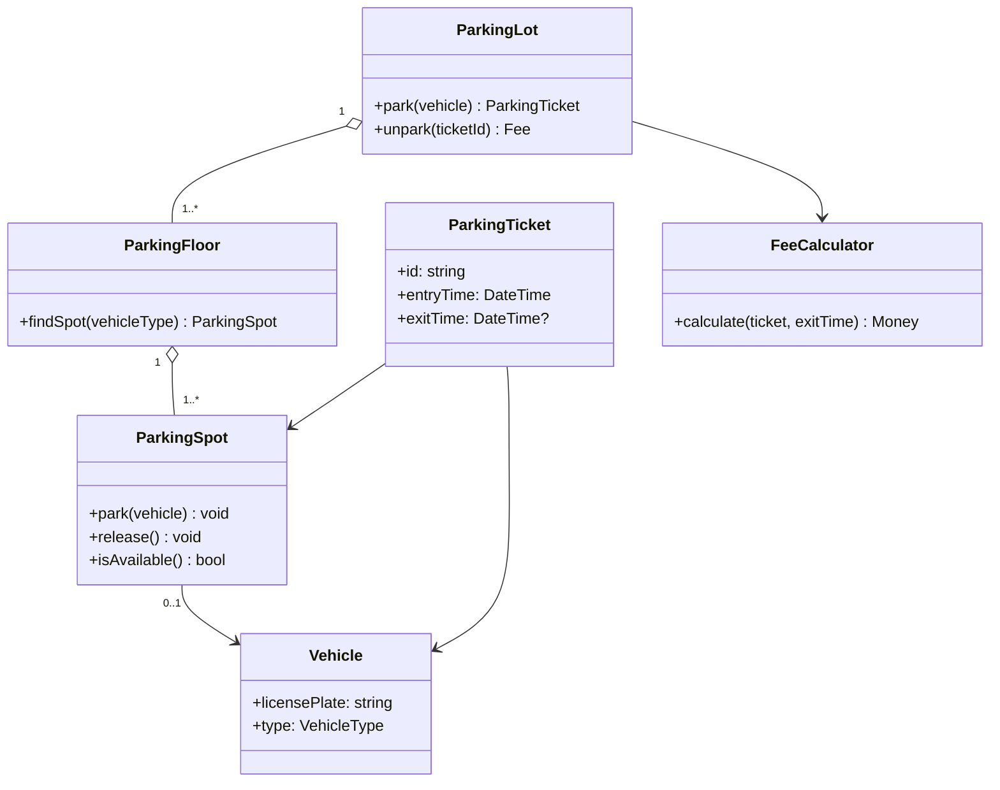

# LLD Question: Design a Parking Lot

**Level:** Beginner

## Interview prompt

Design a parking lot that can park cars and motorcycles. When a vehicle enters, assign it a suitable free parking spot and issue a ticket. When it leaves, close the ticket and calculate the parking fee.

Explain your main classes, how spots are assigned, and what happens when the lot is full.

## Requirements

### Functional requirements

- The lot has a name and one or more floors.
- Each floor has numbered parking spots.
- A spot can hold one vehicle at a time.
- A motorcycle can use a motorcycle spot or a car spot; a car can use only a car spot.
- On entry, find a compatible free spot and create a ticket.
- On exit, calculate the fee from the time parked, free the spot, and close the ticket.
- Tell the driver when no compatible spot is available.

### Assumptions

- The lot uses a simple hourly rate: motorcycles cost $2 per started hour and cars cost $5 per started hour.
- The minimum charge is one hour.
- Payment is represented as a successful operation; payment-provider integration is out of scope.
- For this exercise, one application process handles spot assignment.

## Core objects

| Class | Responsibility |
| --- | --- |
| `ParkingLot` | Owns floors and coordinates entry and exit. |
| `ParkingFloor` | Holds its spots and finds a compatible free spot. |
| `ParkingSpot` | Knows its type and current vehicle; accepts or releases a vehicle. |
| `Vehicle` | Has a license plate and vehicle type. |
| `ParkingTicket` | Records the vehicle, spot, entry time, and optional exit time. |
| `FeeCalculator` | Calculates the fee based on vehicle type and elapsed time. |

## Basic class diagram



## Main flows

### Vehicle enters

1. The attendant or entry gate passes the vehicle to `ParkingLot.park(vehicle)`.
2. The lot asks each floor for a compatible available spot.
3. The chosen spot records the vehicle as occupying it.
4. The lot creates and returns a ticket with a unique ID and entry time.
5. If no spot is found, return a clear `LotFull` result and do not create a ticket.

### Vehicle exits

1. The exit gate looks up the open ticket by its ID.
2. `FeeCalculator` calculates the fee using the entry time, exit time, and vehicle type.
3. After payment succeeds, the ticket is closed and the spot is released.
4. Return the amount charged and the closed ticket.

## Example interfaces

```text
ParkingLot.park(vehicle) -> ParkingTicket | LotFull
ParkingLot.unpark(ticketId, payment) -> Receipt | InvalidTicket | PaymentFailed
ParkingFloor.findSpot(vehicleType) -> ParkingSpot | None
FeeCalculator.calculate(ticket, exitTime) -> Money
```

## Important rules and edge cases

- Do not issue two open tickets for the same spot.
- Do not release a spot if payment fails.
- Reject an unknown or already closed ticket ID.
- Round a partial hour up to the next started hour under the stated pricing assumption.
- Keep spot compatibility in one place, such as `ParkingSpot.canFit(vehicleType)`, rather than scattering type checks.

## Possible follow-up questions

- How would you add buses or accessible spots?
- How would you show available spots on a display board?
- How would you prevent two entry gates from assigning the same spot at once?
- How would you support lost tickets, reservations, or multiple pricing plans?
